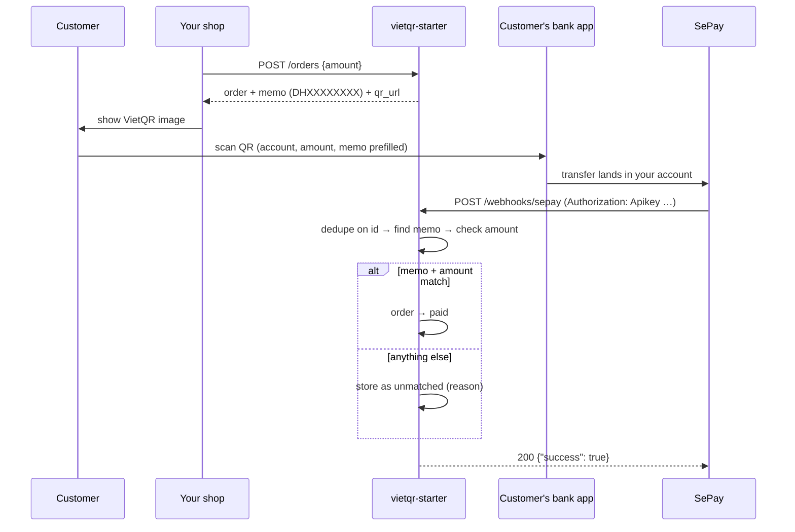

# vietqr-starter

A small Node/TypeScript service for accepting **bank transfers in Vietnam**: show the customer a VietQR code, receive the bank-transfer webhook from [SePay](https://sepay.vn), and confirm the right order automatically.

It covers the parts that break in production:
- each order gets a **unique transfer memo**, so an incoming transfer can be tied to exactly one order
- the webhook is **authenticated** (SePay API key, compared in constant time)
- it is **idempotent** on SePay's transaction `id`, because SePay retries up to 7 times
- the **amount must match exactly**; underpaid, overpaid, unknown-memo and double payments are kept in an **unmatched** table for reconciliation instead of being dropped

Stack: [Hono](https://hono.dev) on Node ≥ 22.13, built-in `node:sqlite`, Vitest.

## How it works



## Quick start

```sh
pnpm install
cp .env.example .env   # fill in your bank account and keys
pnpm test
node --env-file=.env --import tsx src/server.ts
```

Create an order:

```sh
curl -X POST localhost:3000/orders -H 'content-type: application/json' -d '{"amount":150000}'
# → { "id": 1, "memo": "DH7K3QZ9PA", "status": "pending", "qr_url": "https://img.vietqr.io/image/TCB-...-compact2.png?amount=150000&addInfo=DH7K3QZ9PA" }
```

Point SePay at `https://<your-host>/webhooks/sepay`, choose **API Key** authentication, and use the same value as `SEPAY_WEBHOOK_API_KEY`. In SePay's payment-code settings, use the same prefix as `MEMO_PREFIX` so SePay can fill in the `code` field. If it doesn't, the service parses the memo out of `content` itself.

## Endpoints

| Method | Path | Purpose |
|---|---|---|
| POST | `/orders` | Create an order `{ amount }` (integer VND). Returns the memo and the QR URL. |
| GET | `/orders/:id` | Order status (`pending` / `paid`). |
| POST | `/webhooks/sepay` | SePay webhook receiver. |
| GET | `/reconciliation/unmatched` | Transfers that didn't match an order. Requires the `x-admin-key` header. |

### Webhook outcomes

| Outcome | When |
|---|---|
| `matched` | Memo found, order pending, amount equal. The order becomes `paid`. |
| `duplicate` | The same SePay `id` was already processed (retry). Nothing changes. |
| `unmatched` / `no_memo` | No memo in the transfer content. |
| `unmatched` / `unknown_memo` | The memo doesn't belong to any order. |
| `unmatched` / `underpaid` or `overpaid` | The amount differs from the order. |
| `unmatched` / `order_already_paid` | The customer paid twice. Refund or credit them. |
| `unmatched` / `wrong_account` | The transfer went to a different account. |
| `ignored` | Outgoing transfer. |

Every non-duplicate webhook is acknowledged with `200 {"success": true}`. SePay treats anything else as a failure and keeps retrying. Money that arrived is a fact; whether it matches an order is your business logic, which you handle from the unmatched list.

## Design notes

- **Why a memo, not the amount?** Two customers can pay the same amount at the same moment. The memo uses an alphabet without `0/O/1/I`, so it survives being typed by hand.
- **Why search the whole content?** Banks rewrite transfer descriptions (they add sender info, change case, add separators). `extractMemo` normalizes the text and looks for `PREFIX` + 8 characters anywhere in it.
- **Idempotency:** the SePay `id` is the primary key of `transactions`, and the check plus insert run inside one `BEGIN IMMEDIATE` transaction.
- **Not included:** order expiry, partial-payment top-ups, refunds, multi-account routing. Add them for your business rules.

## References

- VietQR quick link format: https://www.vietqr.io/danh-sach-api/link-tao-ma-nhanh/
- SePay webhook payload, API-key header, and retry policy: https://docs.sepay.vn/tich-hop-webhooks.html

## License

MIT
